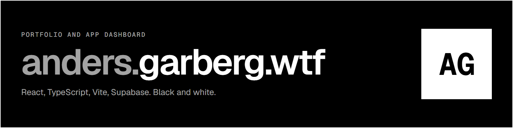

# anders.garberg.wtf

Portfolio and app dashboard for Anders Garberg. Live at [garberg.tech](https://garberg.tech).

React 18, TypeScript, Vite 6. Supabase for auth, profiles and analytics. Netlify for hosting.

## Run

```bash
npm install
cp .env.example .env.local   # Supabase URL and anon key
npm run dev
```

`npm run build` type-checks and builds to `dist/`.

## Structure

```
public/data/        experience, education and projects as JSON, in NO and EN
public/content/     CV and project PDFs
src/components/     Hero, Experience, Projects, About, Contact, Navigation
src/pages/          AboutPage (public), DashboardPage, auth pages
src/i18n/           all UI strings, Norwegian and English
src/styles/         common (tokens), desktop, mobile, dashboard, auth
src/lib/            Supabase client, analytics, app library, icon adapter
```

## Design

Black and white, two modes. Outlined rectangles, zero radius, no shadows, no gradients.
Geist and Geist Mono, self-hosted. Phosphor icons. Content is data; the layout never hard-codes it.

## License

Copyright 2026 Anders Garberg. All rights reserved.
